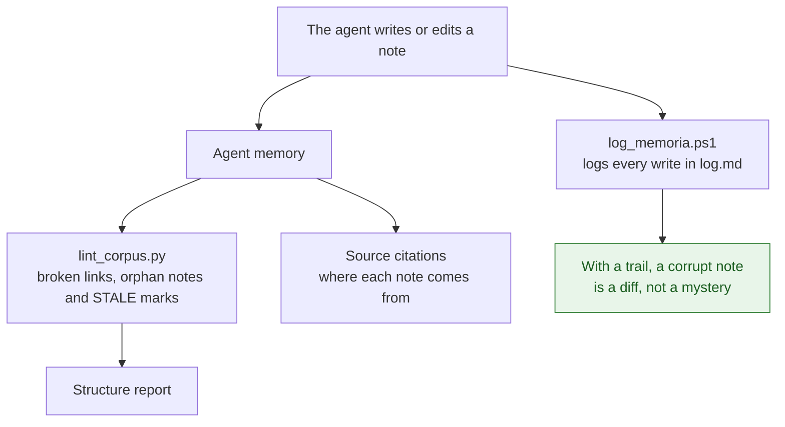

Versión en español: [README.md](README.md)

# agent-memory-governance

Three small pieces to keep an AI agent's persistent memory from turning into a junkyard.
They come from a system in real use: around 100 notes accumulated over two months of daily
work with Claude Code.

## The problem from scratch

If you work daily with an AI agent, sooner or later you will want it to **remember**: the
decisions you made together, the mistakes it already made once, your project's rules. The
usual way to get that is to give it persistent memory: text files the agent reads on startup
and writes to as it works.

Saving is the easy part. What almost nobody tells you is that **that memory rots**. And it
rots in three different ways:

1. **Broken plumbing.** Notes that link to notes that no longer exist, orphan notes that
   nothing references, indexes pointing at deleted files. The agent follows the link and
   finds the void.
2. **Staleness.** Things that were true and stopped being true: last month's figure, the
   path that changed, the decision that was reverted. The note is still there, written with
   the same confidence as day one.
3. **Consistent falsehood.** The worst: a well-written, well-linked note... and false. It
   passes any formal check, and the agent will consult it with full confidence, because one's
   own memory is not questioned.

Storage is solved: there are plenty of public patterns to *save* agent memory. What I did not
find anywhere is the **governance**: who watches what is stored, how the rot is detected, and
what gets in and what does not.

That is what I built.

## The three pieces




### 1. The plumbing linter ([lint_corpus.py](lint_corpus.py))

A dependency-free Python script that checks the corpus structure: `[[...]]` wikilinks that do
not resolve, index pointers to files that do not exist, orphan notes, skill references to
missing documents, and `STALE` markers (content flagged as prone to going out of date).

```
python lint_corpus.py --memory <notes_dir> [--rag <dir>] [--skills <dir>]
```

It also writes a report to `lint_corpus_informe.md` in the current directory. It does not judge
whether the content is true, only whether the structure holds. That is deliberate: a cheap
check you can run daily finds type-1 rot before the agent trips over it.

### 2. The trail from the automatic log ([hooks/log_memoria.ps1](hooks/log_memoria.ps1))

A Claude Code hook (PostToolUse) that appends a line to an append-only `log.md` every time the
agent creates or modifies a note. Date, operation, file, description.

The format matters little. What counts is that it **does not depend on anyone's discipline**,
neither the human's nor the agent's: it fires on its own, on every write the agent makes with
its Write and Edit tools (an edit made by hand outside the agent is not logged). When something
looks wrong in memory, the log tells you when it entered and what it said.

Without a trail, a corrupt note is a mystery; with a trail, it is a diff.

### 3. The origin citations ([docs/convencion_citations.md](docs/convencion_citations.md))

A convention: each note ends by saying **who verified it, against what source, and whether the
check can be re-run today**. A re-runnable note defends itself; one without a source depends on
faith. The document explains the format and the why, with a real example.

## What these pieces do NOT catch (and it is worth saying plainly)

The lint catches inconsistency, but not **consistent falsehood**: a well-formatted lie passes
the lint, gets logged with its date, and can even carry a flawless citations block. The three
pieces solve type-1 rot, contain type-2 (STALE markers + dated citations) and leave type-3
flagged but unsolved. To catch a consistent falsehood you need something more expensive:
**verify the claim against the primary source of its domain**, that is, run the query or launch
the test again. That is the fourth piece.

And the fourth piece is frozen on purpose.

## Why the fourth piece is frozen

The design exists: an **admission arbiter** with a generic interface
(`domain + claim + evidence -> ADMIT / REJECT / ADMIT_DEGRADED + reason`), pluggable by domain.
In my case, the accounting domain would verify against MySQL; other domains would plug in their
own source of truth.

I froze it before building it. Reviewing the whole path, I found two things:

1. Of ~100 notes in the real corpus, only 15-20 had real admission risk. The problem the arbiter
   attacks is smaller than it looked from the inside.
2. The original problem (that the right information *reaches* the agent at the moment of need,
   retrieval) was still untouched. I was about to build the fourth admission piece with zero
   retrieval pieces.

Building the arbiter would have been following inertia: the next step of the plan, not the next
step of the problem. The rule I applied to myself is the same one that governs the notes:
**governance applies to the roadmap too**. It thaws the day there is evidence that the manual
method (verify on use, not on save) is not enough.

## Where this comes from

From the TechAcces project: a fictitious company with real accounting (~17,000 journal lines in
MySQL) on which I develop swarms of Claude agents with continuous evaluation. Two months of daily
sessions generate a lot of memory, and the problems above are not hypothetical: all three kinds
of rot showed up for real.

An anecdote that captures the spirit: on its first pass over the real corpus, the linter reported
two problems... that were **bugs in the linter itself** (it did not understand legitimate
cross-repository references and marked as broken the links cited as examples inside code). The
linter was fixed, not the corpus. The watchdog is watched too: nothing is taken as good without
checking, not even the verifier. More than a framework, this is three small pieces and a
criterion, so copy them and adapt them to your corpus.

And keep the question that gives rise to them: *who watches what your agent remembers?*

## Related projects

This harness is one piece of a larger body of work on multi-agent systems. The sibling pieces:

- [claude-code-context-management](https://github.com/jleonceo/claude-code-context-management): the direct sibling of this repo. Here we govern *what* the agent remembers; there, *how much* of it loads each session, so the context files (CLAUDE.md and MEMORY.md) do not bloat the context.
- [llm-eval-contable](https://github.com/jleonceo/llm-eval-contable): the same philosophy (measure before you trust) applied to a skill, what it is and how it is examined.
- [accounting-agent-swarm](https://github.com/jleonceo/accounting-agent-swarm): the system whose knowledge this harness governs, with its drops explained.
- [gobernanza-skills-analiticas](https://github.com/jleonceo/gobernanza-skills-analiticas): the five rules for governing skills, each with its real scar.
- [orquestacion-enjambres-ia](https://github.com/jleonceo/orquestacion-enjambres-ia): multi-agent routing, which agent handles each request without breaking as it grows.
- [verificacion-determinista-ia](https://github.com/jleonceo/verificacion-determinista-ia): state coherence checked by pure arithmetic, without AI.
- [tu-primer-asistente-ia-web](https://github.com/jleonceo/tu-primer-asistente-ia-web): what an AI assistant is, for absolute beginners.
- [tesoreria-forecast-ia](https://github.com/jleonceo/tesoreria-forecast-ia): cash-flow forecasting by decomposition with backtesting, plus ratios and aging.
- [control-interno-fraude-ia](https://github.com/jleonceo/control-interno-fraude-ia): accounting fraud detection with arithmetic, inside an internal-control framework.

---

Built by [Juan Luis León Rodríguez](https://juanluisleon.vercel.app) · June 2026 · [MIT](LICENSE) licence
