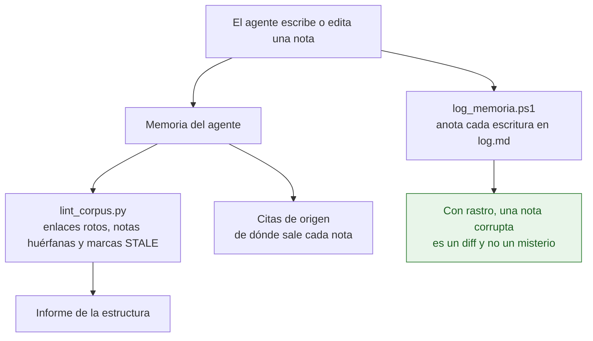

English version: [README.en.md](README.en.md)

# agent-memory-governance

Tres piezas pequeñas para que la memoria persistente de un agente de IA no se convierta
en un vertedero. Salen de un sistema en uso real: unas 100 notas acumuladas en dos meses
de trabajo diario con Claude Code.

## El problema explicado desde cero

Si trabajas a diario con un agente de IA, tarde o temprano querrás que **recuerde**: las
decisiones que tomasteis, los errores que ya cometió una vez, las reglas de tu proyecto.
La forma habitual de conseguirlo es darle memoria persistente, o sea ficheros de texto que
el agente lee al arrancar y va escribiendo mientras trabaja. Guardar es la parte fácil, y
es la que cuenta todo el mundo. Lo que casi nadie cuenta es que **esa memoria se pudre**.

Se pudre de tres formas distintas:

1. **Fontanería rota.** Notas que enlazan a notas que ya no existen, notas huérfanas que
   nada referencia, índices que apuntan a ficheros borrados. El agente sigue el enlace y
   encuentra el vacío.
2. **Caducidad.** Cosas que fueron verdad y dejaron de serlo: la cifra de hace un mes, la
   ruta que cambió, la decisión que se revirtió. La nota sigue ahí, escrita con la misma
   seguridad que el primer día.
3. **Falsedad consistente.** La peor: una nota bien escrita y bien enlazada... y falsa.
   Pasa cualquier comprobación de forma, y el agente la consultará con total confianza,
   porque la memoria propia no se cuestiona.

El almacenamiento está resuelto: hay patrones públicos de sobra para *guardar* memoria
de agente. Lo que no encontré en ningún sitio es la **gobernanza**: quién vigila lo
guardado, cómo se detecta lo podrido, y qué entra y qué no.

Esto es lo que construí.

## Las tres piezas




### 1. El linter de fontanería ([lint_corpus.py](lint_corpus.py))

Un script de Python sin dependencias que revisa la estructura del corpus: wikilinks
`[[...]]` que no resuelven, punteros del índice a ficheros que no existen, notas huérfanas,
referencias de las skills a documentos ausentes, y marcas `STALE` (contenido señalado como
sensible a quedarse obsoleto).

```
python lint_corpus.py --memory <dir_de_notas> [--rag <dir>] [--skills <dir>]
```

Escribe además un informe en `lint_corpus_informe.md` en el directorio actual. No juzga si
el contenido es verdad, solo si la estructura se sostiene. Es deliberado:
una comprobación barata que se puede ejecutar a diario encuentra la podredumbre de
tipo 1 antes de que el agente tropiece con ella.

### 2. El rastro del log automático ([hooks/log_memoria.ps1](hooks/log_memoria.ps1))

Un hook de Claude Code (PostToolUse) que añade una línea a un `log.md` append-only cada
vez que el agente crea o modifica una nota. Fecha, operación, fichero, descripción.

El formato importa poco. Lo que vale es que **no depende de la disciplina de nadie**, ni
del humano ni del agente: se dispara solo, en cada escritura del agente con sus herramientas
Write y Edit (una edición hecha a mano fuera del agente no queda registrada). Cuando algo
aparece mal en la memoria, el log te dice cuándo entró y qué decía.

Sin rastro, una nota corrupta es un misterio; con rastro, es un diff.

### 3. Las citas de origen ([docs/convencion_citations.md](docs/convencion_citations.md))

Una convención: cada nota termina diciendo **quién la verificó, contra qué fuente, y si
la comprobación se puede re-ejecutar hoy**. Una nota re-ejecutable se defiende sola; una
sin fuente depende de la fe. El documento explica el formato y el porqué, con ejemplo real.

## Lo que estas piezas NO cazan (y conviene decirlo claro)

El lint caza la inconsistencia. La **falsedad consistente** se le escapa entera: una
mentira bien formateada pasa el lint, queda registrada con su fecha y hasta puede llevar
un bloque de citas impecable. Así que conviene ser exacto con lo que cubren estas tres
piezas. Resuelven la podredumbre de tipo 1, acotan la de tipo 2 con las marcas STALE y las
citas fechadas, y dejan la de tipo 3 señalada y sin resolver. Para cazar una falsedad
consistente hace falta algo más caro: **verificar la afirmación contra la fuente primaria
de su dominio**, o sea ejecutar la consulta o lanzar el test otra vez. Eso es la cuarta
pieza.

Y la cuarta pieza está congelada a propósito.

## Por qué la cuarta pieza está congelada

El diseño existe: un **árbitro de admisión** con interfaz genérica
(`dominio + afirmación + evidencia → ADMITIR / RECHAZAR / ADMITIR_DEGRADADO + razón`),
enchufable por dominio. En mi caso, el dominio contable verificaría contra MySQL; otros
dominios enchufarían su propia fuente de verdad.

Lo congelé antes de construirlo. Al revisar el camino completo encontré dos cosas:

1. De ~100 notas del corpus real, solo 15-20 tenían riesgo real de admisión. El problema
   que el árbitro ataca es más pequeño de lo que parecía desde dentro.
2. El problema original (que la información correcta *llegue* al agente en el momento
   de necesidad, la recuperación) seguía sin tocar. Estaba a punto de construir la cuarta
   pieza de admisión teniendo cero piezas de recuperación.

Construir el árbitro habría sido seguir por inercia: el siguiente paso del plan, no el
siguiente paso del problema. La regla que me apliqué es la misma que gobierna las notas:
**la gobernanza también se aplica al roadmap**. Se descongela el día que haya evidencia
de que el método manual (verificar al usar, no al guardar) no basta.

## De dónde sale esto

Del proyecto TechAcces: una empresa ficticia con contabilidad de verdad, sobre la que
desarrollo enjambres de agentes Claude con evaluación continua. El diario operativo lleva
17.382 asientos a 31/07/2026, contados con una consulta a un disco privado. Esa cifra
**no es reproducible** desde este repositorio. Va como contexto de dónde salió el problema
y no como resultado que puedas comprobar. Dos meses de sesiones diarias generan mucha
memoria. Los problemas de arriba no son hipotéticos: los tres tipos de podredumbre
aparecieron de verdad.

Una anécdota que resume el espíritu: en su primera pasada sobre el corpus real, el linter
reportó dos problemas... que eran **fallos del propio linter** (no entendía referencias
legítimas entre repositorios y marcaba como rotos los enlaces citados como ejemplo dentro
de código). Se corrigió el linter, no el corpus. La herramienta de vigilancia también se
vigila: nada se da por bueno sin comprobar, tampoco el verificador. Más que un framework,
esto son tres piezas pequeñas y un criterio, así que cópialas y adáptalas a tu corpus.

Y quédate con la pregunta que las origina: *¿quién vigila lo que tu agente recuerda?*

## Relación con otros proyectos

Este harness es una pieza de un trabajo más amplio sobre sistemas con varios agentes. Las piezas hermanas:

- [claude-code-context-management](https://github.com/jleonceo/claude-code-context-management): la hermana directa de este repo. Aquí se gobierna *qué* recuerda el agente; allí, *cuánto* de eso se carga cada sesión, para que los ficheros de contexto (CLAUDE.md y MEMORY.md) no saturen el contexto.
- [llm-eval-contable](https://github.com/jleonceo/llm-eval-contable): la misma filosofía (medir antes de confiar) aplicada a una skill, qué es y cómo se examina.
- [accounting-agent-swarm](https://github.com/jleonceo/accounting-agent-swarm): el sistema cuyo conocimiento gobierna este harness, con sus caídas explicadas.
- [gobernanza-skills-analiticas](https://github.com/jleonceo/gobernanza-skills-analiticas): las cinco reglas para gobernar skills, cada una con su cicatriz real.
- [orquestacion-enjambres-ia](https://github.com/jleonceo/orquestacion-enjambres-ia): el enrutado multi-agente, a qué agente va cada petición sin romper al crecer.
- [verificacion-determinista-ia](https://github.com/jleonceo/verificacion-determinista-ia): la coherencia del estado comprobada por pura aritmética, sin IA.
- [tu-primer-asistente-ia-web](https://github.com/jleonceo/tu-primer-asistente-ia-web): qué es un asistente de IA, para quien empieza de cero.
- [tesoreria-forecast-ia](https://github.com/jleonceo/tesoreria-forecast-ia): previsión de caja por descomposición con backtesting, más ratios y aging.
- [control-interno-fraude-ia](https://github.com/jleonceo/control-interno-fraude-ia): detección de fraude contable con aritmética, dentro de un marco de control interno.

---

Construido por [Juan Luis León Rodríguez](https://juanluisleon.vercel.app) · junio 2026 · Licencia [MIT](LICENSE)
